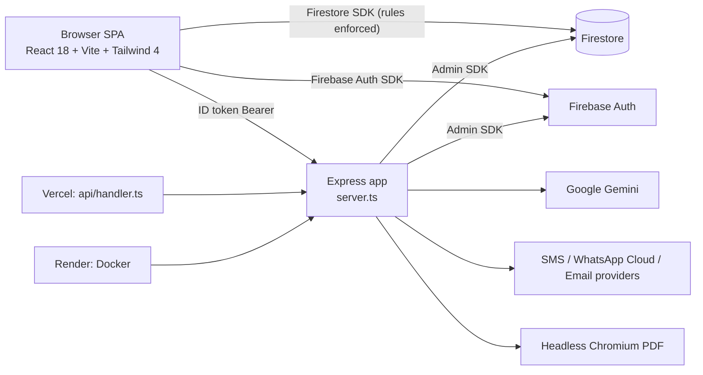

# ARCHITECTURE

## Overview
Single repository, one Express server + React SPA, backed by Firebase (Auth + Firestore). Multi-tenant (one "school" = one tenant). Arabic-first, RTL UI. Evidence: `server.ts`, `src/App.tsx`, `firestore.rules`.

## Layers
- **Frontend (`src/`)**: `App.tsx` resolves tenant by hostname → `AttendanceProvider` (one 3,406-line provider holding all state, Firestore listeners/writes, API calls) → `MainAppContent` (login gate, subscription gate, tab router, no URL router). Views are lazy-loaded. Contexts: `AttendanceContext`, `ThemeContext`.
- **Backend (`server.ts`)**: middleware chain `json(25 MB) → helmet → [PDF route] → rate limiters → authenticateRequest → requireTenant → requireActiveSubscription → routes`. 24 API routes + static SPA fallback.
- **Database**: Firestore only (12 collections, see DATABASE.md). No SQL.
- **Auth**: Firebase Auth email/password (+ Google popup code path); server identity from **custom claims** `{role, tenantId}`.
- **AuthZ**: server `requireRole`/`requirePlatformOwner`/`requireTenant`; Firestore rules (profile-based roles, tenant scoped, subscription gated); UI tab guard (not a security boundary).
- **AI**: Gemini via `@google/genai`, per-tenant encrypted key, fallback to platform key.
- **Storage**: no file/object storage; excuse attachments are base64 inside Firestore documents (`attachmentUrl`).
- **Background jobs / cron / webhooks**: **Not present in the inspected repository** (digest "scheduler" settings exist in UI; no server scheduler found — digest dispatch is user-triggered).
- **Logging**: `console.*` only. **Error handling**: per-route try/catch with generic messages; React `ErrorBoundary`.
- **Testing**: Vitest (unit + one HTTP integration file) and emulator-based scripts (not run).
- **Config**: env vars (`.env.example`), `src/config/*`, Firestore `tenants` overlay, `dynamicTenants.json`.

## Deployment targets (both defined)
Vercel (`vercel.json`, `api/handler.ts`, 1024 MB / 60 s, `@sparticuz/chromium`) and Render (`render.yaml`, Dockerfile, Node 22, system Chromium, free plan).

## Tenant resolution flow
Host → `resolveTenantFromHostname` (query `?tenant=` → local-dev fallbacks → custom domain → first host label) → `authenticateRequest` (404/403 for unknown/inactive) → `requireTenant` (claim tenant must equal host tenant unless `super_admin`).

## Request trace example (justification excuse analysis)
`JustificationsView` → `authenticatedFetch('/api/analyze-image')` → auth chain → handler validates MIME/magic bytes → `callGeminiWithFallback` (tenant key→system key) → JSON → UI; saving is a separate client `setDoc(justifications/{id})` in `createJustification`.
