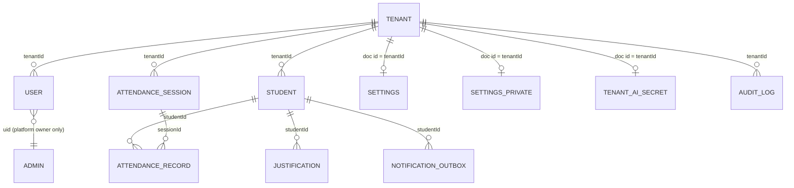

# DATABASE

Firestore only (default database id `(default)` unless `VITE_FIREBASE_FIRESTORE_DATABASE_ID`). Types: `src/types/attendance.ts`. Rules: `firestore.rules` (default deny, then per collection). Indexes: `firestore.indexes.json` (4 composite: `tenantId+guardianPhone` on students/attendance_records/justifications; `tenantId+recipientPhone` on notification_outbox). Migrations: **none** (schemaless; only `scripts/backfill-user-claims.mjs` backfills auth claims). `firebase-blueprint.json` describes entities (its `Admin.role` enum includes `admin`; the rules accept only `super_admin` — inconsistency).

No foreign-key/cascade enforcement exists (Firestore). Deleting a student (`deleteStudent`) deletes only `students/{id}`; related records remain (UNKNOWN whether the client also removes them — not seen in the `deleteDoc` call site).

## Collections (rules-enforced constraints)
| Collection | Key | Fields (type source) | Rule constraints | Access (rules) |
|---|---|---|---|---|
| `admins` | uid | `email`, `role='super_admin'` | `isValidAdmin` | get: self or owner; list/write: owner |
| `tenants` | tenantId | `TenantDomainConfig` + `subscription` | none | **read: anyone (`if true`)**; write: owner |
| `users` | uid | `userId, tenantId, name, email, role, phone?, jobTitle?, assignedClasses?, assignedSubjects?, status?, createdAt?` | role ∈ admin/registrar/teacher/parent; sizes ≤ limits; **create by non-owner: self + role `parent` only** | get: self/admin/registrar(same tenant)/owner; update self (role, tenant, phone, email immutable); delete owner |
| `students` | `isValidId` | `Student` (23 fields) | requires studentNumber, fullName, className, tenantId; sizes | read: staff of tenant; parent if `guardianPhone`/`guardianEmail`/`id` matches profile; create/update admin+registrar; delete admin |
| `attendance_sessions` | id | `AttendanceSession` (records embedded as array) | tenantId,date,sessionType∈{daily,period},className,status∈{draft,submitted,reopened} | read staff; create admin/registrar/assigned teacher; update: admin/registrar, or teacher while draft/reopened; delete admin |
| `attendance_records` | id | `StudentAttendanceRecord` (per-student mirror) | **no validation function** | read staff; parent by `guardianPhone`; create/update `isTeacherAssigned`; delete admin |
| `justifications` | id | `Justification` (51 fields incl. `aiAnalysis`, `attachmentUrl` base64) | reasonType, status enums; explanation ≤1000 | read staff, parent by phone/student id; create staff, or parent/teacher as `pending`; update admin/registrar; delete admin |
| `notification_outbox` | id | `NotificationOutboxItem` | channel∈{SMS,WhatsApp}, status∈{pending,sent,failed}, text ≤500 | read admin/registrar, parent by `recipientPhone`; create admin/registrar/teacher; update admin/registrar; delete admin |
| `audit_logs` | id | `AuditLog` | required fields; **update/delete forbidden** | read admin/registrar; create staff |
| `settings` | tenantId | `{settings, schoolProfile, updatedAt, updatedBy}` | none | read tenant users; write tenant admin |
| `settings_private` | tenantId | `{messagingGateway:{sms/email/whatsapp credentials}}` | none | read/write tenant admin |
| `tenant_ai_secrets` | tenantId | `{iv, tag, data, maskedKey, updatedAt, preferredModel}` | no rule ⇒ **default deny**; Admin SDK only | server |
| `test` | `connection` | — | default deny | read probe only |

Tenant boundary: every rule compares `tenantId` with the profile's tenant (`isTenantRole`/`isTenantUser`), plus subscription gate `tenantAccessAllowed` (reads `tenants/{id}.subscription`; `accessUntilMs`=0 ⇒ never expires). `isAdmin()` = existence of `admins/{uid}` with `super_admin` (owner bypass).

## Not persisted
`StudentBehaviourIncident`, `DailyEmailDigestConfig`, `DailyEmailDigestItem[]` history: stored only via `localCache` (memory) — no collection or rule exists (QA-05).

## Important queries (client)
Listeners in `AttendanceProvider`: students, attendance_sessions (non-parent), justifications, notification_outbox, audit_logs, users — each `where('tenantId','==',tenantId)`; parent variants add `guardianPhone`/`recipientPhone` equality; `settings/{tenant}`, `settings_private/{tenant}` (admins), `attendance_records` (parents).

## Security implications
See SEC-01/02/03/07/08 in SECURITY_AUDIT.md.
