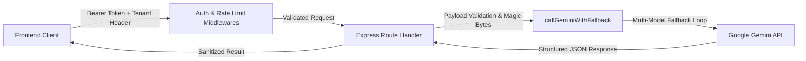

# AI Architecture & Document Analysis Engine

## Overview

The Smart School Attendance System incorporates Google Gemini AI via `@google/genai` to support school operations in three key domains:
1. **Medical Excuse & Document Forensic Analysis** (`POST /api/analyze-image`).
2. **Executive Attendance Morning Briefing & Anomaly Discovery** (`POST /api/daily-digest/generate-briefing`).
3. **Interactive School Attendance Policy Chatbot** (`POST /api/chat`).

---

## AI Request Pipeline & Security Controls

### Security & Abuse Defenses

1. **Endpoint Authentication & Authorization**:
   - Guarded by `authenticateToken`, `requireRole`, and `requireTenant` middlewares.
   - Unauthenticated or cross-tenant requests are rejected with 401/403.
2. **Granular Rate Limiting**:
   - Express rate limiters protect expensive AI endpoints (`/api/chat`: 20 req/min, `/api/analyze-image`: 10 req/min, `/api/daily-digest/*`: 10 req/min).
3. **Strict Payload & Binary Magic Byte Validation**:
   - Maximum upload cap: **5 MB**.
   - Binary magic byte validation verifies file signatures (`JPEG`, `PNG`, `PDF`, `WEBP`) before forwarding buffers to Gemini, neutralizing file spoofing.
4. **Multi-Model High-Availability Fallback**:
   - `callGeminiWithFallback` iterates across redundant models (`gemini-2.5-flash`, `gemini-1.5-flash`, `gemini-1.5-pro`) to ensure high availability during quota spikes.
