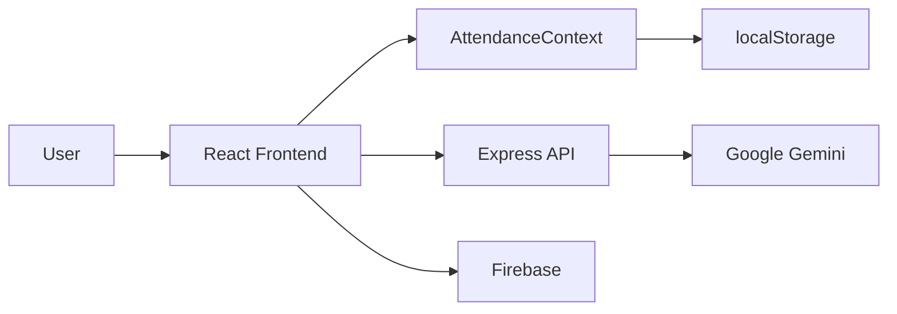

# Architecture

## High-level overview

The app is a client-driven school operations dashboard with:

- React frontend for staff and parent workflows
- Express backend serving AI endpoints
- Firebase Auth and Firestore for identity and persistence
- browser localStorage fallbacks for data handling
- Google Gemini for document analysis and briefings

## Runtime layers

- Presentation: `src/components/*`, `src/App.tsx`
- State: `src/context/AttendanceContext.tsx`
- Types: `src/types/attendance.ts`
- Data access: Firebase + localStorage
- API: `server.ts`
- AI: Gemini via `@google/genai`

## Architectural flow

## Assessment

The implementation is feature-rich and coherent, but it depends heavily on client-side state and not-yet-strong backend enforcement. The UI is structured around role-specific views for admin, teacher, registrar, and parent.
