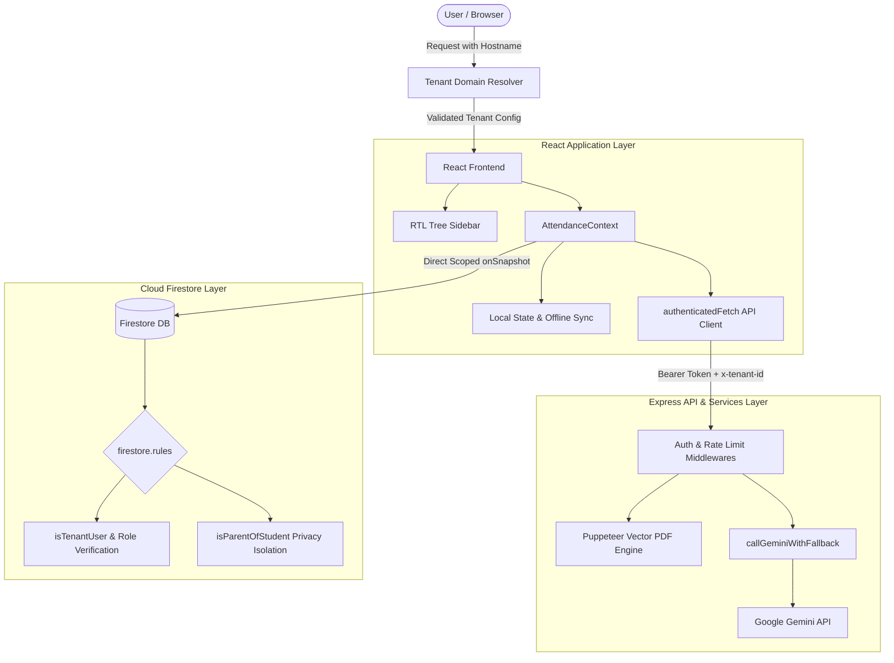

# Architecture Blueprint

## High-Level Overview

The Smart School Attendance System ("مدرستي حضور") is architected with a decoupled full-stack TypeScript design enforcing multi-tenant isolation, defense-in-depth authorization, and strict compliance:

- **Frontend Presentation Layer**: React 18, Vite, TypeScript, and Tailwind CSS (RTL support) structured into modular subcomponents and an expandable Tree Sidebar (`AppSidebar.tsx`).
- **Application State & Data Management**: `AttendanceContext.tsx` with real-time Firestore listeners, multi-tenant scoping, and RBAC capability flags.
- **Backend API & Service Layer**: Express (`server.ts`) guarding AI routes, enforcing hostname-based tenant validation (`requireTenant`), and generating vector A4 Arabic PDFs via Puppeteer.
- **Database & Persistence Layer**: Firebase Firestore with fine-grained security rules (`firestore.rules`) and parent-child privacy isolation.
- **Artificial Intelligence Integration**: Google Gemini via `@google/genai` for document forensics and morning executive briefings.

---

## Architectural Flow

---

## Architectural Hardening & Verification

- **Backend Enforcement**: Defense-in-depth across 3 layers (Firestore Rules, Express middlewares, frontend context flags).
- **Settings Single Source of Truth**: All operational parameters derived from `TenantSchoolProfile` in Settings, including dynamic country presets and ministerial letterheads.
- **QR Attendance 3-Condition Architecture**: Explicit modal confirmation before roster pending reset, deferred absence finalization with late arrival adjustment (5-45m), duplicate scan prevention with amber alerts and audio warning, and exact timestamp recording.
- **Dynamic Multi-Tenant Domain Resolution**: Cross-origin persistence via `dynamicTenants.json` and server resolution API (`/api/tenant/resolve`) allowing instant provisioning of new schools.
- **Automated Test Harness**: 192 automated tests across 27 suites in Vitest (`npm test`) with 100% pass rate.
- **Security & Secret Compliance**: 0 secrets committed; local verification via `npm run audit`.
